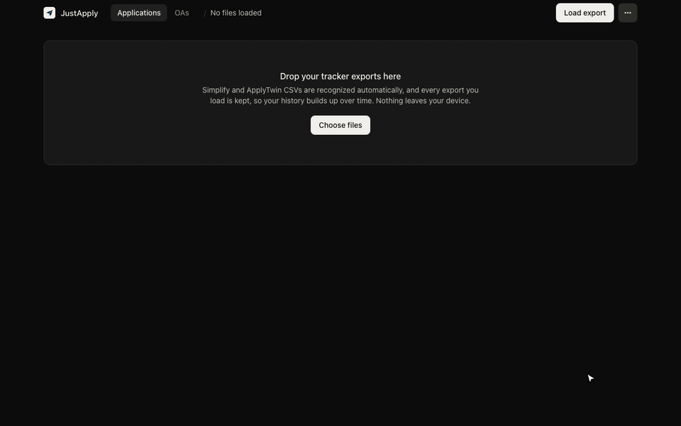

# JustApply

Most job tracker ui's are a pain to use. 

JustApply turns your csv exports into a clean dashboard: how many applications heard back, who replied, what's still waiting, and which days you applied.

Runs locally on your computer. Nothing is uploaded anywhere.



In the demo: drop in a Simplify export, switch the date range, open who replied and how long the rest have waited, click a day in the calendar to see what you applied to, then log an OA and watch its weak topic show up.

## Run it

You need [Node.js](https://nodejs.org) 18 or newer.

```bash
npx justapply
```

That starts JustApply at `http://localhost:4545` and opens it in your browser. Press `Ctrl+C` in the terminal to stop it.

Then drop in your exports:

- **Simplify:** Tracker → Export to CSV
- **ApplyTwin:** export your applications as CSV

You can load exports from more than one app at once; JustApply combines them and removes duplicates. Load a newer export any time and it shows what's new.

Options: `npx justapply --port 4546` uses a different port, and `--no-open` skips opening the browser.

## What it does

- **Combine multiple CSVs from different apps.** Load your Simplify and ApplyTwin exports together (or any CSV with company, role and status columns) and see everything in one place.
- **Detects duplicates.** The same job showing up in two files, or listed twice in one, is counted once. It matches the posting ID in each job link (Workday, Greenhouse, Lever, Ashby and more), then company and role.
- **Counts only real applications.** Saved, skipped and unfinished rows are left out.
- **Funnel:** heard back, screens, offers, rejections, and what's still waiting or ghosted (no reply after 30 days).
- **Heard back list, waiting clock, and an applying calendar.** Click a day to see what you applied to.
- **Edit statuses** for updates your tracker doesn't have yet.
- **OA notebook:** log each assessment's questions by topic and how they went, plus what went well, what went wrong and what to do next time.
- **Weekly goal:** set a target, track this week's progress and your streak.
- **Share a summary image:** a clean card of your totals. No company names are shown.
- **Download your applications as a clean CSV.**

## Your data

Your data is saved in your browser, tied to `localhost:4545`, so keep using the same port. To keep it safe for the long term:

- **Auto-save to a file** (Chrome, Edge, Arc, Brave): ⋯ menu → Auto-save to a file. Put it in iCloud Drive or Dropbox and it's backed up and synced.
- **Backups:** ⋯ menu → Download backup, and Restore from backup on any machine.

In Chrome you can also click the install icon in the address bar to give JustApply its own window and Dock icon. It works offline.

## License

MIT. Bundled libraries are listed in `vendor/LICENSES.md`.
